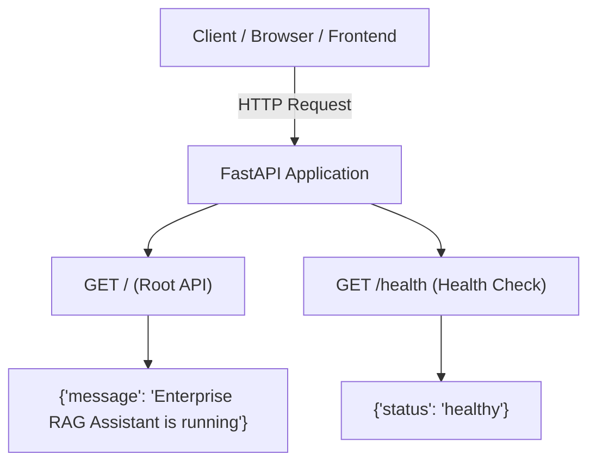
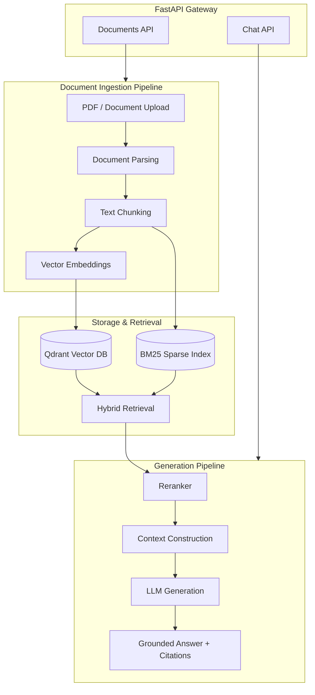

# (DAY 1) Project — Enterprise RAG Knowledge Assistant

## Step 1 — FastAPI Foundation

---

### 1. Objective
In this step, we will build the working backend foundation of our **Enterprise RAG Knowledge Assistant** using FastAPI.

At this stage, we will not add Qdrant, embeddings, PDF processing, chunking, or LLM integration.

The goal is to first understand:
- How a FastAPI backend is structured.
- How APIs and routes are created.
- How the server runs using Uvicorn.
- How endpoints are tested.

---

### 2. What You Will Build
By the end of this step, your application should:
- [x] Run successfully on a local FastAPI server.
- [x] Provide a root API endpoint (`GET /`).
- [x] Provide a health-check endpoint (`GET /health`).
- [x] Automatically generate Swagger API documentation (`/docs`).
- [x] Follow a clean backend project structure separating code from documentation.
- [x] Establish the foundation for the complete Enterprise RAG system.

---

### 3. Project Structure
The project is organized with a clear separation of code, documentation, and storage:

```text
enterprise_rag/
│
├── app/                       # Application backend source code
│   ├── __init__.py            # Makes app a Python package
│   └── main.py                # Main entry point of the FastAPI application
│
├── docs/                      # Documentation and lecture notes
│   ├── README.md              # Documentation overview
│   └── lecture_01_fastapi_foundation.md  # Day 1 lecture guide
│
├── storage/                   # Application data & file storage
│   └── uploads/               # Will store uploaded documents (PDFs, docs, etc.)
│
├── .gitignore                 # Specifies files/folders Git should ignore
├── README.md                  # Project overview & quickstart guide
└── requirements.txt           # Project dependencies
```

#### Purpose of Files & Folders

| File / Folder | Purpose |
| :--- | :--- |
| `app/` | Contains the FastAPI application code |
| `app/main.py` | Main entry point of the FastAPI application |
| `app/__init__.py` | Makes `app` a Python package |
| `docs/` | Contains lecture notes, architecture designs, and guides |
| `storage/` | Used for application storage |
| `storage/uploads/` | Will later store uploaded documents |
| `requirements.txt` | Contains project dependencies (`fastapi`, `uvicorn`, etc.) |
| `.gitignore` | Specifies files/folders Git should ignore (e.g. `.venv/`, `__pycache__/`) |

---

### 4. Setup Instructions

#### 4.1 Create Folders
```powershell
mkdir app
mkdir storage
mkdir storage\uploads
mkdir docs
```

#### 4.2 Create & Activate Virtual Environment
A virtual environment keeps dependencies isolated:
```powershell
python -m venv .venv
.venv\Scripts\activate
```

Verify Python installation:
```powershell
python --version
```

#### 4.3 Install Dependencies
```powershell
pip install fastapi "uvicorn[standard]"
```

Verify FastAPI installation:
```powershell
pip show fastapi
```

---

### 5. Application Code (`app/main.py`)

```python
from fastapi import FastAPI
from fastapi.middleware.cors import CORSMiddleware

app = FastAPI(
    title="Enterprise RAG Knowledge Assistant",
    version="1.0.0",
    description="Enterprise RAG system built with FastAPI"
)

# Configure CORS
app.add_middleware(
    CORSMiddleware,
    allow_origins=["*"],
    allow_credentials=True,
    allow_methods=["*"],
    allow_headers=["*"],
)


@app.get("/")
async def root():
    return {
        "message": "Enterprise RAG Assistant is running"
    }


@app.get("/health")
async def health_check():
    return {
        "status": "healthy"
    }
```

---

### 6. Code Explanation

#### 6.1 Import FastAPI
```python
from fastapi import FastAPI
```
Imports the FastAPI framework used to build RESTful backend APIs.

#### 6.2 Application Instance
```python
app = FastAPI(
    title="Enterprise RAG Knowledge Assistant",
    version="1.0.0",
    description="Enterprise RAG system built with FastAPI"
)
```
Creates the main FastAPI application instance. Metadata (`title`, `version`, `description`) will appear directly in the OpenAPI documentation.

#### 6.3 Root API (`GET /`)
```python
@app.get("/")
async def root():
    return {
        "message": "Enterprise RAG Assistant is running"
    }
```
Creates an HTTP GET endpoint at path `/`. When requested, FastAPI executes `root()` and converts the Python dictionary into a JSON response.

#### 6.4 Understanding `async`
`async def root()` defines an asynchronous function. FastAPI supports non-blocking asynchronous request handling, which is crucial for I/O-bound operations such as:
- Database reads/writes
- External API calls
- File uploads & chunking
- Embedding generation
- Calling LLMs (OpenAI, Anthropic, Gemini, Ollama, etc.)

#### 6.5 Health Check API (`GET /health`)
```python
@app.get("/health")
async def health_check():
    return {
        "status": "healthy"
    }
```
Exposes a standard health check endpoint used by Docker, Kubernetes, reverse proxies, and uptime monitors.

---

### 7. Running the Server

Make sure your virtual environment is active in the project root:
```powershell
uvicorn app.main:app --reload --port 8000
```

#### Explanation of Arguments:
- `app.main:app`:
  - `app` $\rightarrow$ Folder/package name
  - `main` $\rightarrow$ `main.py` file
  - `app` $\rightarrow$ FastAPI application instance variable
- `--reload`: Enables hot-reloading upon file modifications during development.
- `--port 8000`: Binds the server to port 8000.

---

### 8. Testing Endpoints

| Endpoint | Method | Expected Output |
| :--- | :--- | :--- |
| `http://localhost:8000/` | GET | `{"message": "Enterprise RAG Assistant is running"}` |
| `http://localhost:8000/health` | GET | `{"status": "healthy"}` |
| `http://localhost:8000/docs` | GET | Interactive Swagger UI |

#### Testing via Swagger UI:
1. Open `http://localhost:8000/docs` in your browser.
2. Select **GET /health**.
3. Click **Try it out** $\rightarrow$ **Execute**.
4. Verify response: `{"status": "healthy"}`.

---

### 9. Architecture

#### Step 1: Initial Backend Foundation


#### Final Target Architecture for Enterprise RAG


---

### 10. Future Backend Directory Evolution

As we progress through the subsequent steps, `app/` will scale cleanly into:

```text
app/
├── __init__.py
├── main.py
├── config.py
├── schemas.py
├── core/
│   ├── config.py
│   └── security.py
├── routers/
│   ├── documents.py
│   └── chat.py
└── services/
    ├── ingestion.py
    ├── chunking.py
    ├── embeddings.py
    ├── retrieval.py
    ├── reranking.py
    └── generation.py
```

---

### 11. Step 1 Checklist

- [x] Project folder `enterprise_rag` created.
- [x] Virtual environment `.venv` created & activated.
- [x] `fastapi` & `uvicorn` installed.
- [x] `app/main.py` created with root & health endpoints.
- [x] Server runs via `uvicorn app.main:app --reload --port 8000`.
- [x] `GET /` returns success message.
- [x] `GET /health` returns status healthy.
- [x] Swagger UI opens at `/docs`.
- [x] Git repository configured and pushed to GitHub.
