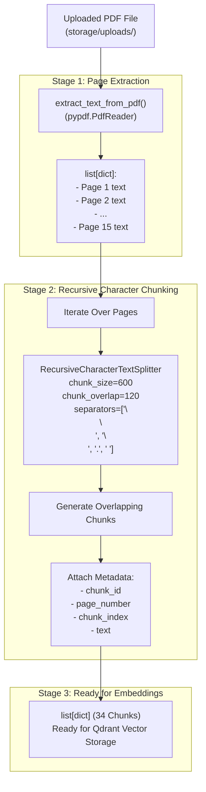

# (DAY 3) Project — Enterprise RAG Knowledge Assistant

## Step 3 — Text Chunking Strategies

---

### 1. Objective

In Step 2, we built the document upload API and extracted raw text page-by-page from PDF files. However, raw extracted text cannot be sent directly into a Vector Database or LLM context. 

Enterprise documents often span dozens or hundreds of pages. If we convert an entire page or document into a single vector embedding:
1. **Semantic Dilution**: Dense vector models compress text into a fixed-dimensional space (e.g., 384, 768, or 1536 dimensions). Compressing thousands of words into one vector flattens distinct topics and significantly degrades semantic search accuracy.
2. **Context Window Waste**: Injecting oversized passages into an LLM prompt burns token budget and distracts the model with irrelevant content ("Lost in the Middle" phenomenon).
3. **Loss of Citation Precision**: If a chunk represents an entire multi-page chapter, citations cannot pinpoint the exact paragraph or sentence that supports the answer.

In **Step 3**, we implement **Text Chunking** using LangChain's `RecursiveCharacterTextSplitter`. Chunking divides raw text into semantically cohesive, overlapping segments while preserving full metadata lineage (`chunk_id`, `page_number`, `chunk_index`).

---

### 2. What You Will Build

By the end of this step, your application includes:
- [x] Integration of `langchain-text-splitters` into the project dependencies (`requirements.txt`).
- [x] Implementation of `chunk_pdf_pages()` in `app/core/ingestion.py`.
- [x] Intelligent hierarchical splitting using `RecursiveCharacterTextSplitter`.
- [x] Configurable chunking parameters (`chunk_size=600`, `chunk_overlap=120`, custom separators).
- [x] Preservation of page-level and global chunk metadata for grounded source citations.
- [x] A standalone test script (`app/test/test_chunking.py`) validating the chunking pipeline.

---

### 3. The Science of Chunking: Size & Overlap

Choosing the right chunking strategy is one of the most critical decisions in RAG system design.

```text
Raw Extracted Text (Page 1)
┌────────────────────────────────────────────────────────┐
│ Paragraph A: Overview of FastAPI and Async Execution   │
│ Paragraph B: Setting up Uvicorn Development Server     │
│ Paragraph C: Testing with Swagger UI and OpenAPI Docs  │
└────────────────────────────────────────────────────────┘
                           │
             Recursive Character Splitting
           (chunk_size=600, chunk_overlap=120)
                           │
         ┌─────────────────┴─────────────────┐
         ▼                                   ▼
┌─────────────────────────┐         ┌─────────────────────────┐
│ Chunk 0 (Page 1, Idx 0) │         │ Chunk 1 (Page 1, Idx 1) │
│ Covers Paragraph A & B  │         │ Covers End of B & C     │
│                         │<───────>│                         │
│ [....overlap window...] │         │ [...overlap window...]  │
└─────────────────────────┘         └─────────────────────────┘
```

#### 3.1 The Chunk Size Trade-Off (`chunk_size`)
- **Too Large (e.g., > 2000 characters)**:
  - Embeddings become generic averages of multiple ideas.
  - Cosine similarity matching becomes fuzzy.
  - Less room in LLM prompt for multiple relevant sources.
- **Too Small (e.g., < 200 characters)**:
  - Chunks lack surrounding context (e.g., a pronoun like *"It runs on port 8000"* without knowing what *"It"* refers to).
  - High risk of splitting sentences awkwardly in the middle.
- **Optimal Enterprise Range (500–1000 characters / ~150–250 tokens)**:
  - Preserves 1 to 2 complete paragraphs of coherent thought.
  - Allows top-$K$ retrieval (e.g., top 4 chunks) to provide diverse context to the LLM.

#### 3.2 Why Chunk Overlap Matters (`chunk_overlap`)
When text is split strictly at character limits, critical facts or sentences that cross the boundary get sliced in half.
- `chunk_overlap=120` (~20% of `chunk_size`) creates a **sliding window**.
- The tail of Chunk 0 is repeated at the head of Chunk 1.
- This ensures that relationships between adjacent sentences are never lost during vector similarity searches.

---

### 4. Why `RecursiveCharacterTextSplitter`?

Standard text splitters split purely by character count or on single characters (e.g. spaces). This often breaks words, formulas, or sentences.

`RecursiveCharacterTextSplitter` works hierarchically by trying to split text in order of structural importance:

1. **`"\n\n"` (Paragraph breaks)**: Keeps full paragraphs together whenever possible.
2. **`"\n"` (Line breaks)**: Keeps lists and lines intact if a paragraph exceeds `chunk_size`.
3. **`"."` (Sentence terminators)**: Keeps full sentences together if lines are too long.
4. **`" "` (Spaces)**: Splits between words as a fallback.
5. **`""` (Characters)**: Emergency fallback to prevent chunks from exceeding hard limits.

---

### 5. Implementation Code (`app/core/ingestion.py`)

Here is the complete implementation of `chunk_pdf_pages()` added to `app/core/ingestion.py`:

```python
from pathlib import Path
from pypdf import PdfReader
from langchain_text_splitters import RecursiveCharacterTextSplitter

def extract_text_from_pdf(file_path: str) -> list[dict]:
    """
    Extracts text from each page of a given PDF file.
    """
    pdf_path = Path(file_path)

    if not pdf_path.exists():
        raise FileNotFoundError(f"PDF file not found : {file_path}")

    reader = PdfReader(str(pdf_path))
    extracted_page = []

    for page_number, page in enumerate(reader.pages, start=1):
        text = page.extract_text() or ""
        extracted_page.append({
            "page_number": page_number,
            "text": text.strip()
        })

    return extracted_page


def chunk_pdf_pages(
    pages: list[dict],
    chunk_size: int = 600,
    chunk_overlap: int = 120,
) -> list[dict]:
    """
    Splits extracted PDF pages into smaller, semantically coherent chunks
    while preserving page numbers and generating chunk metadata.
    
    Args:
        pages (list[dict]): List of dictionaries with 'page_number' and 'text'.
        chunk_size (int): Maximum character length per chunk (default: 600).
        chunk_overlap (int): Number of overlapping characters between chunks (default: 120).
        
    Returns:
        list[dict]: List of structured chunks with metadata.
    """
    splitter = RecursiveCharacterTextSplitter(
        chunk_size=chunk_size,
        chunk_overlap=chunk_overlap,
        separators=["\n\n", "\n", ".", " "],
        length_function=len,
    )

    chunks = []

    for page in pages:
        page_text = page.get("text", "")

        # Skip empty pages
        if not page_text:
            continue

        # Split text into overlapping segments
        page_chunks = splitter.split_text(page_text)

        # Build chunk metadata
        for chunk_index, chunk_text in enumerate(page_chunks):
            chunks.append({
                "chunk_id": len(chunks),               # Global unique chunk ID
                "page_number": page["page_number"],   # Source PDF page number
                "chunk_index": chunk_index,           # Position index within this page
                "text": chunk_text,                   # Actual text content
            })

    return chunks
```

---

### 6. Metadata Structure for RAG

Each generated chunk contains four key metadata fields:

| Field | Type | Description | Purpose in RAG |
| :--- | :--- | :--- | :--- |
| `chunk_id` | `int` | Sequential global ID (`0, 1, 2, ...`) | Primary key for Vector DB payload and storage mapping. |
| `page_number` | `int` | 1-based index of original PDF page | Displayed in LLM citations (e.g. *"See Page 3"*). |
| `chunk_index` | `int` | Index of chunk on that specific page (`0, 1, ...`) | Tracks order of content within the same page. |
| `text` | `str` | Segment text (up to ~600 chars) | Input for embedding generation and LLM prompt context. |

---

### 7. Standalone Testing (`app/test/test_chunking.py`)

To verify that chunking works reliably, we create a dedicated test script `app/test/test_chunking.py`:

```python
import sys
from pathlib import Path

# Ensure UTF-8 output encoding on Windows consoles
if sys.stdout:
    sys.stdout.reconfigure(encoding="utf-8", errors="replace")

# Add project root to sys.path so 'app' can be imported from any directory
PROJECT_ROOT = Path(__file__).resolve().parent.parent.parent
if str(PROJECT_ROOT) not in sys.path:
    sys.path.insert(0, str(PROJECT_ROOT))

from app.core.ingestion import extract_text_from_pdf, chunk_pdf_pages

# Resolve PDF path relative to project root
upload_dir = PROJECT_ROOT / "storage" / "uploads"
target_file = upload_dir / "(DAY 1)Project  — Enterprise RAG Knowledge Assistant .pdf"
if not target_file.exists():
    target_file = upload_dir / "(DAY 1)Project — Enterprise RAG Knowledge Assistant .pdf"
    if not target_file.exists():
        pdf_matches = list(upload_dir.glob("*.pdf"))
        if pdf_matches:
            target_file = pdf_matches[0]

pdf_path = str(target_file)

# 1. Extract pages
pages = extract_text_from_pdf(pdf_path)
print(f"Total extracted pages: {len(pages)}")

# 2. Chunk pages
chunks = chunk_pdf_pages(pages, chunk_size=600, chunk_overlap=120)
print(f"Total generated chunks: {len(chunks)}\n")

# 3. Print first 3 chunks as examples
for chunk in chunks[:3]:
    print(f"--- Chunk ID: {chunk['chunk_id']} | Page: {chunk['page_number']} | Index: {chunk['chunk_index']} ---")
    print(f"Text ({len(chunk['text'])} chars):\n{chunk['text'][:300]}...\n")
```

#### How to Run the Test:

```powershell
# From the project root:
python -m app.test.test_chunking

# Or from inside app/test:
cd app\test
python test_chunking.py
```

#### Expected Output:
```text
Total extracted pages: 15
Total generated chunks: 34

--- Chunk ID: 0 | Page: 1 | Index: 0 ---
Text (595 chars):
(DAY 1) Project — Enterprise RAG Knowledge Assistant
Step 1 — FastAPI Foundation
Objective
In this step, we will build the working backend foundation...

--- Chunk ID: 1 | Page: 1 | Index: 1 ---
Text (587 chars):
structured, how APIs are created, how the server runs, and how endpoints can be tested.
What You Will Build...
```

---

### 8. Key Engineering Bugs Diagnosed & Solved

During the implementation of `chunk_pdf_pages`, three subtle bugs were identified and fixed:

1. **SyntaxError (Missing Comma in Constructor)**:
   ```python
   # INCORRECT:
   separators=["\n\n","\n","."," "]
   length_function = len,
   
   # CORRECT:
   separators=["\n\n", "\n", ".", " "],
   length_function=len,
   ```

2. **TypeError on Variable Name (`pages` vs `page`)**:
   ```python
   # INCORRECT (pages is a list, cannot subscript with string):
   for page in pages:
       page_text = pages["text"]  # Raises TypeError: list indices must be integers or slices, not str
       
   # CORRECT:
   for page in pages:
       page_text = page.get("text", "")
   ```

3. **Loop Indentation Bug (`return` inside loop)**:
   ```python
   # INCORRECT (prematurely returns after processing only page 1):
   for page in pages:
       ...
       return chunks
       
   # CORRECT (returns after all pages are processed):
   for page in pages:
       ...
   return chunks
   ```

---

### 9. Pipeline Architecture Diagram



---

### 10. Updated Dependencies (`requirements.txt`)

Our dependencies now include `langchain-text-splitters` for robust text preprocessing:

```text
fastapi>=0.110.0
uvicorn[standard]>=0.28.0
pydantic>=2.0.0
pypdf>=5.1.0
python-multipart>=0.0.9
langchain-text-splitters>=0.3.0
```

---

### 11. Step 3 Completion Checklist

- [x] Installed `langchain-text-splitters>=0.3.0` in the virtual environment.
- [x] Updated `requirements.txt` with `langchain-text-splitters`.
- [x] Implemented `chunk_pdf_pages()` in `app/core/ingestion.py`.
- [x] Configured hierarchical text splitting with `chunk_size=600` and `chunk_overlap=120`.
- [x] Preserved page numbers, chunk index, and global chunk IDs.
- [x] Created and executed `app/test/test_chunking.py`.
- [x] Verified that 15 PDF pages produce 34 coherent text chunks without loss of context.

---

### 12. Preview: What Comes Next in Day 4

Now that our text is chunked into 34 digestible passages with metadata:
- **Embeddings**: We will use an embedding model (e.g., `sentence-transformers` or OpenAI/HuggingFace embeddings) to convert each text chunk into a high-dimensional vector.
- **Vector Database (Qdrant)**: We will set up Qdrant (local or containerized) and create a collection.
- **Payload Indexing**: We will upsert vectors into Qdrant along with their metadata (`page_number`, `chunk_id`, `text`) for semantic similarity search.
