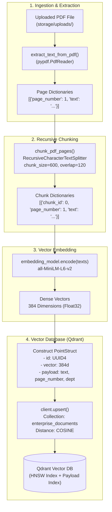

# (DAY 4) Project — Enterprise RAG Knowledge Assistant

## Step 4 — Embeddings & Vector Database (Qdrant)

---

### 1. Objective

In **Step 3**, we implemented intelligent text chunking using `RecursiveCharacterTextSplitter`, converting multi-page enterprise PDFs into discrete, overlapping text chunks while preserving critical metadata like `page_number` and `chunk_id`.

However, chunks in raw string format cannot be mathematically compared for semantic similarity. Keyword searches fail when queries use synonyms, paraphrased questions, or different phrasing than the original document.

In **Step 4**, we build the storage and retrieval engine of our RAG pipeline:
1. **Dense Vector Embeddings**: Convert human text passages into dense mathematical vectors using `sentence-transformers`.
2. **Vector Database (Qdrant)**: Connect to Qdrant, create an enterprise collection with Cosine distance indexing, and persist vectors alongside structured metadata payloads.
3. **Enterprise Filtering**: Attach multi-tenant metadata (`department`, `page_number`, `chunk_id`) to every vector point, enabling role-based access control (RBAC) and high-accuracy filtering during retrieval.

---

### 2. What You Will Build

By the end of this step, your application includes:
- [x] Integration of `sentence-transformers` and `qdrant-client` into `requirements.txt`.
- [x] Core vector storage module (`app/core/vector_store.py`).
- [x] Dense embedding generation using `sentence-transformers/all-MiniLM-L6-v2` (384 dimensions).
- [x] Automated Qdrant collection creation (`create_collection()`) configured with Cosine distance metric.
- [x] Batch chunk upsert function (`store_chunks()`) creating points with unique UUIDs and rich metadata payloads.
- [x] Standalone verification test script (`app/test/test_vector_store.py`).
- [x] Docker setup instructions and dashboard access for Qdrant.

---

### 3. Understanding Dense Embeddings

#### 3.1 What is an Embedding?
An embedding model maps text (words, sentences, or paragraphs) into a continuous high-dimensional vector space:

$$\text{Text Chunk} \xrightarrow{\text{Embedding Model}} \vec{v} \in \mathbb{R}^{384}$$

In this geometric space, sentences with similar semantic meanings are placed close together, even if they share zero overlapping keywords.

```text
Query: "How do I deploy on port 8000?"
                       │
             Cosine Distance Check
                       │
       ┌───────────────┴───────────────┐
       ▼                               ▼
Chunk A (High Similarity):       Chunk B (Low Similarity):
"Setting up Uvicorn on           "Invoice billing policies
 port 8000 for FastAPI"           for annual enterprise contracts"
 [Score: 0.88]                    [Score: 0.12]
```

#### 3.2 Model Choice: `sentence-transformers/all-MiniLM-L6-v2`
- **Output Dimensions**: `384` floating-point numbers per vector.
- **Speed & Efficiency**: Extremely lightweight (~80 MB model size), fast inference on CPU and GPU.
- **Context Window**: 256 tokens (matches our 600-character chunking strategy perfectly).
- **Quality**: Proven benchmark performance on semantic textual similarity (STS) and retrieval benchmarks.

#### 3.3 Distance Metrics
Qdrant supports multiple distance metrics:
- **Cosine Similarity (`models.Distance.COSINE`)**: Measures the cosine of the angle between two vectors, invariant to vector magnitude. **Optimal for normalized text embeddings.**
- **Dot Product (`models.Distance.DOT`)**: Fast dot product calculation (requires vectors to be unit normalized).
- **Euclidean Distance (`models.Distance.EUCLID`)**: Straight-line distance in Euclidean space.

For `all-MiniLM-L6-v2`, **Cosine Distance** is the industry standard.

---

### 4. Vector Database Architecture: Why Qdrant?

A relational database (e.g., PostgreSQL without extensions) or key-value store cannot efficiently search through millions of high-dimensional vectors. A specialized Vector Database is required.

#### Key Advantages of Qdrant:
1. **High Performance**: Implemented in Rust with memory-mapped vector storage and SIMD hardware acceleration.
2. **Payload-First Architecture**: Vectors are stored alongside arbitrary JSON payloads (`text`, `department`, `page_number`, `chunk_id`). This avoids external relational lookups during query time.
3. **HNSW Indexing**: Uses Hierarchical Navigable Small World graphs for sub-millisecond Approximate Nearest Neighbor (ANN) search.
4. **Filtered Search**: Enables filtering queries by enterprise metadata (e.g., *"Search only within `department == 'Legal'`"*).

```text
Qdrant Point Structure:
┌────────────────────────────────────────────────────────┐
│ Point ID: "550e8400-e29b-41d4-a716-446655440000" (UUID)│
├────────────────────────────────────────────────────────┤
│ Vector:   [0.0421, -0.1205, 0.0891, ..., 0.0152] (384) │
├────────────────────────────────────────────────────────┤
│ Payload:  {                                            │
│   "text": "Paragraph content extracted from PDF...",  │
│   "chunk_id": 0,                                       │
│   "chunk_index": 0,                                    │
│   "page_number": 1,                                    │
│   "department": "Engineering"                          │
│ }                                                      │
└────────────────────────────────────────────────────────┘
```

---

### 5. Running Qdrant Locally with Docker

Qdrant runs as a lightweight containerized service.

#### Run Qdrant with Docker:
```bash
docker run -d \
  --name qdrant \
  -p 6333:6333 \
  -p 6334:6334 \
  -v qdrant_storage:/qdrant/storage \
  qdrant/qdrant
```

#### Port Mapping:
- **`6333`**: HTTP REST API and Qdrant Web Dashboard UI.
- **`6334`**: gRPC interface for high-throughput streaming.

#### Qdrant Web Dashboard:
Once running, open your browser and navigate to:
```text
http://localhost:6333/dashboard
```
The dashboard allows you to visually inspect collections, view vector counts, examine payload schemas, and run test vector queries directly from your browser.

---

### 6. Implementation Code (`app/core/vector_store.py`)

Here is the complete implementation of the vector store integration:

```python
import uuid
from sentence_transformers import SentenceTransformer
from qdrant_client import QdrantClient, models

# Global configuration constants
COLLECTION_NAME = "enterprise_documents"
EMBEDDING_MODEL_NAME = "sentence-transformers/all-MiniLM-L6-v2"
VECTOR_SIZE = 384

# Connect to Qdrant (Docker or remote instance running on port 6333)
client = QdrantClient(url="http://localhost:6333")

# Load embedding model
embedding_model = SentenceTransformer(EMBEDDING_MODEL_NAME)


def create_collection():
    """Create the Qdrant collection if it does not already exist."""
    if not client.collection_exists(COLLECTION_NAME):
        client.create_collection(
            collection_name=COLLECTION_NAME,
            vectors_config=models.VectorParams(
                size=VECTOR_SIZE,
                distance=models.Distance.COSINE
            )
        )


def store_chunks(chunks: list[dict], department: str) -> int:
    """
    Generate dense embeddings for chunks and store them in Qdrant with metadata payload.

    Args:
        chunks: List of text chunk dictionaries with keys:
                'text', 'chunk_id', 'chunk_index', 'page_number'
        department: Department metadata for enterprise access control and filtering

    Returns:
        Total number of points upserted
    """
    if not chunks:
        return 0

    # 1. Batch encode text chunks into 384-dimensional dense vectors
    texts = [chunk["text"] for chunk in chunks]
    vectors = embedding_model.encode(texts, show_progress_bar=True).tolist()

    # 2. Build Qdrant PointStruct objects with UUID and payload
    points = []
    for chunk, vector in zip(chunks, vectors):
        points.append(
            models.PointStruct(
                id=str(uuid.uuid4()),
                vector=vector,
                payload={
                    "text": chunk["text"],
                    "chunk_id": chunk["chunk_id"],
                    "chunk_index": chunk["chunk_index"],
                    "page_number": chunk["page_number"],
                    "department": department,
                }
            )
        )

    # 3. Upsert points into Qdrant collection
    client.upsert(
        collection_name=COLLECTION_NAME,
        points=points,
        wait=True
    )

    return len(points)
```

#### Detailed Breakdown:
1. **`client = QdrantClient(url="http://localhost:6333")`**: Initializes a connection client to the Qdrant server. Connections are opened lazily upon the first request.
2. **`SentenceTransformer(EMBEDDING_MODEL_NAME)`**: Downloads and caches the weights for `all-MiniLM-L6-v2` locally (stored under `~/.cache/huggingface/hub/`).
3. **`client.collection_exists(...)`**: Checks whether the collection already exists before attempting creation, avoiding duplicate creation errors.
4. **`models.VectorParams(size=384, distance=COSINE)`**: Declares the dimensionality and similarity metric for indexing.
5. **Batch Encoding (`embedding_model.encode(texts)`)**: Generates vectors in batches rather than one-by-one, maximizing CPU/GPU throughput.
6. **`models.PointStruct`**: Represents an indexed record in Qdrant, containing a unique UUID string, the 384-dimensional vector, and the JSON payload metadata.
7. **`client.upsert(..., wait=True)`**: Upserts the points and waits for Qdrant's write-ahead log (WAL) and memory index to confirm completion.

---

### 7. Standalone Testing & Verification (`app/test/test_vector_store.py`)

A dedicated verification script tests the entire pipeline from PDF extraction to chunking and vector storage:

```python
import sys
from pathlib import Path

# Ensure UTF-8 output encoding on Windows consoles
if sys.stdout:
    sys.stdout.reconfigure(encoding="utf-8", errors="replace")

PROJECT_ROOT = Path(__file__).resolve().parent.parent.parent
if str(PROJECT_ROOT) not in sys.path:
    sys.path.insert(0, str(PROJECT_ROOT))

from app.core.ingestion import extract_text_from_pdf, chunk_pdf_pages

# 1. Resolve sample PDF path
upload_dir = PROJECT_ROOT / "storage" / "uploads"
pdf_matches = list(upload_dir.glob("*.pdf"))
if not pdf_matches:
    print("❌ No sample PDF files found in storage/uploads/")
    sys.exit(1)

pdf_path = str(pdf_matches[0])
print(f"📄 Testing with PDF: {pdf_matches[0].name}")

# 2. Extract and chunk text
pages = extract_text_from_pdf(pdf_path)
print(f"✅ Total extracted pages: {len(pages)}")

chunks = chunk_pdf_pages(pages, chunk_size=600, chunk_overlap=120)
print(f"✅ Total generated chunks: {len(chunks)}")

# 3. Import and test Vector Store & Embedding Model
try:
    from app.core.vector_store import (
        embedding_model,
        create_collection,
        store_chunks,
        client,
        COLLECTION_NAME,
        VECTOR_SIZE,
    )

    sample_text = chunks[0]["text"]
    sample_vector = embedding_model.encode([sample_text])[0]
    print(f"✅ Embedding model loaded: sentence-transformers/all-MiniLM-L6-v2")
    print(f"✅ Generated embedding dimensions: {len(sample_vector)} (Expected: {VECTOR_SIZE})")

    # 4. Test Qdrant Vector Store connection
    print(f"\n🔍 Testing connection to Qdrant...")
    try:
        client.get_collections()
        print("✅ Connected to Qdrant server successfully!")

        create_collection()
        print(f"✅ Collection '{COLLECTION_NAME}' is ready.")

        department = "Engineering"
        total_stored = store_chunks(chunks[:5], department=department)
        print(f"✅ Successfully stored {total_stored} chunks for department '{department}' in Qdrant!")

    except Exception as exc:
        print(f"⚠️  Note: Could not connect to Qdrant server ({exc}).")
        print("👉 To run Qdrant locally using Docker, execute:")
        print("    docker run -p 6333:6333 -p 6334:6334 -v $(pwd)/storage/qdrant_storage:/qdrant/storage:z qdrant/qdrant")

except OSError as err:
    if "c10.dll" in str(err) or "DLL" in str(err):
        print(f"\n⚠️  Windows PyTorch DLL Notice: {err}")
        print("👉 PyTorch requires Microsoft Visual C++ Redistributable on Windows.")
        print("👉 Download and install from: https://aka.ms/vs/17/release/vc_redist.x64.exe")
    else:
        raise
```

#### Running the Test:
```bash
python app/test/test_vector_store.py
```

#### Windows Note (PyTorch C++ Runtime):
On Windows, PyTorch depends on the Microsoft Visual C++ Redistributable package (`vc_redist.x64.exe`). If missing, you may see:
```text
OSError: [WinError 126] The specified module could not be found. Error loading "...torch\lib\c10.dll"
```
Installing the redistributable from Microsoft resolves this immediately.

---

### 8. End-to-End Pipeline Architecture Diagram



---

### 9. Updated Dependencies (`requirements.txt`)

Our dependencies now include both `sentence-transformers` and `qdrant-client`:

```text
fastapi>=0.110.0
uvicorn[standard]>=0.28.0
pydantic>=2.0.0
pypdf>=5.1.0
python-multipart>=0.0.9
langchain-text-splitters>=0.3.0
sentence-transformers>=3.0.0
qdrant-client>=1.9.0
```

---

### 10. Step 4 Completion Checklist

- [x] Added `sentence-transformers` and `qdrant-client` to `requirements.txt`.
- [x] Created `app/core/vector_store.py` with Qdrant client connection and embedding model setup.
- [x] Configured collection schema with 384 vector dimensions and Cosine distance.
- [x] Implemented `store_chunks()` to batch-encode text chunks and attach rich payload metadata (`text`, `chunk_id`, `chunk_index`, `page_number`, `department`).
- [x] Added backward-compatible alias `app/core/vecotor_store.py` for previous typo safety.
- [x] Built standalone test script `app/test/test_vector_store.py` validating the pipeline.
- [x] Documented Docker commands for running local Qdrant server and accessing dashboard.

---

### 11. Preview: What Comes Next in Day 5

Now that documents are embedded and indexed in Qdrant:
- **Hybrid Retrieval (Dense + Sparse / BM25)**: Dense vector search is exceptional at semantic understanding, but keyword-based BM25 search excels at exact matches (e.g., product IDs, SKU numbers, person names).
- **Reciprocal Rank Fusion (RRF)**: We will combine the rankings of dense vector search and BM25 sparse search for state-of-the-art enterprise retrieval accuracy.
